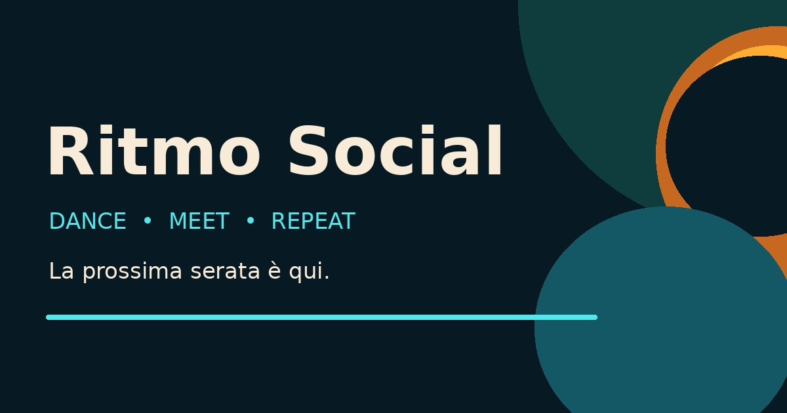

<div align="center">


# Ritmo Social ✳

### Dance · Meet · Repeat

**Le serate caraibiche, le persone e la community in un solo posto.**  
Scopri, organizza e vivi serate di bachata, salsa, kizomba e merengue, con un'esperienza progettata prima di tutto per smartphone.

[](https://react.dev/)
[](https://www.typescriptlang.org/)
[](https://vite.dev/)
[](https://tailwindcss.com/)
[](https://ritmo-social-theta.vercel.app/)


[**Apri la demo**](https://ritmo-social-theta.vercel.app/) · [**Funzionalità**](#-cosa-puoi-fare) · [**Avvio locale**](#-avvio-in-locale) · [**Roadmap**](#-roadmap)



</div>

> [!IMPORTANT]
> **Stato: MVP / demo, non prodotto multiutente pronto per utenti reali.** Senza configurazione Supabase, i dati vengono salvati solo nel browser tramite `localStorage`; registrazioni, chat, approvazioni e pagamenti reali non sono attivi. Non utilizzare l'app per raccogliere posizioni private reali finché non saranno verificate le autorizzazioni lato server.

## 💃 Cosa puoi fare

| Scopri | Partecipa | Organizza | Connettiti |
|:---|:---|:---|:---|
| Ricerca serate per stile, città, zona e distanza | Richiedi l'accesso a un evento e segui lo stato della richiesta | Crea eventi con un wizard mobile in 4 passaggi | Chat globale e chat legate agli eventi |
| Esplora una mappa con pin, cluster e anteprime | Vedi il luogo preciso **solo dopo l'approvazione** nel modello previsto | Definisci capienza, orari, prezzi e zona pubblica | Profili personali con città, bio e stili preferiti |

**Esperienza mobile-first:** navigazione inferiore, schede compatte, input ottimizzati per Safari iOS, chat con tastiera, data e ora separate, e pulsanti di partecipazione sempre accessibili.

## 🧩 Stack

- **Frontend:** React 18, Vite 6, TypeScript, Tailwind CSS 3, React Router, Lucide.
- **Mappe:** Leaflet + React Leaflet + OpenStreetMap, pin su **zone indicative** (non indirizzi di locali).
- **Backend predisposto, ma non ancora convalidato in produzione:** Supabase Auth, PostgreSQL, Row Level Security, Realtime, Edge Functions.
- **Pagamenti predisposti, non attivi nella demo:** Stripe Checkout / webhook.
- **Deploy:** Vercel, SPA routing.

## 🚀 Avvio in locale

Richiede **Node.js 20+** e npm.

```bash
npm install
npm run dev
```

Apri `http://localhost:5173`. La demo parte anche senza variabili d'ambiente, utilizzando dati e chat locali. Non usare indirizzi personali reali nei test.

```bash
npm run check     # TypeScript
npm test          # Test automatici
npm run build     # Compilazione produzione
npm run preview   # Anteprima della build locale
```

Per ripristinare la demo, usa il comando di reset nella pagina Profilo.

### Variabili d'ambiente

```bash
cp .env.example .env
```

| Variabile | Dove | Descrizione |
|---|---|---|
| `VITE_SUPABASE_URL` | Frontend | URL del progetto Supabase |
| `VITE_SUPABASE_PUBLISHABLE_KEY` | Frontend | Chiave pubblica Supabase |
| `STRIPE_SECRET_KEY` | Solo Edge Functions | Segreto Stripe, **mai nel frontend** |
| `STRIPE_WEBHOOK_SECRET` | Solo Edge Functions | Firma webhook, **mai nel frontend** |
| `STRIPE_PRICE_ID` | Solo Edge Functions | Prezzo ricorrente configurato in Stripe |

**Non committare mai** `.env`, service-role key, token, credenziali o chiavi Stripe private. La presenza di una migration SQL nel repository **non significa** che sia stata applicata a un database reale.

## 🗺️ Privacy e geolocalizzazione

Le serate pubblicano una **zona approssimativa**, utile per la ricerca entro un raggio (per esempio 10 km). I dati per identificare il locale sono separati dai dati pubblici e dovranno essere recuperabili soltanto dall'organizzatore o da partecipanti approvati, **con policy RLS verificate**. I controlli React da soli non bastano a proteggere un indirizzo privato.

Prima di attivare Supabase live servono test multiaccount, conferme transazionali a capienza limitata, regole di accesso alle chat, revoca dei permessi dopo l'annullamento e moderazione.

## 📁 Struttura del progetto

```text
src/
  App.tsx              # Router e shell applicativa
  components/          # Layout, mappa, card e componenti condivisi
  data/                # Contenuti demo
  lib/                 # Store demo/live, geografia, client Supabase
  pages/               # Esplora, evento, creazione, chat, profilo, Plus
public/                # Logo, favicon, icone PWA, Open Graph
supabase/
  migrations/          # Schema SQL / RLS da validare
  functions/           # Edge Functions Checkout / webhook
 tests/                # Smoke, UX e regression test
 docs/                 # Architettura, monetizzazione e archivio versioni
```

## 🧪 Test e rilascio

La v0.4.1 ha superato **24 test automatici** riportati nel collaudo della demo e una build TypeScript/Vite su Vercel. I flussi fondamentali sono stati verificati manualmente su iPhone nella modalità demo; questo non equivale a test end-to-end del backend con utenti reali.

Esegui `npm audit` e valuta gli aggiornamenti di dipendenze prima del rilascio: durante la build v0.4.1 sono state segnalate **6 vulnerabilità (1 moderata, 5 alte)**. Completa moderazione delle chat, antispam, documentazione privacy e sicurezza RLS prima di aprire l'app al pubblico.

## 💸 Monetizzazione: accesso gratuito, sponsor contestuali

Il prodotto è pensato per rendere **ricerca, iscrizioni e chat gratuite**. L'esperimento commerciale prioritario è la vendita di **serate sponsorizzate** e piccoli spazi pubblicitari locali, sempre contrassegnati come tali, evitando interruzioni in chat o durante un'iscrizione. Il prototipo conserva una schermata Plus a pagamento per analisi e confronti, **senza pagamenti attivi**.

Vedi [Strategia di monetizzazione](docs/MONETIZATION.md) per stime, ipotesi e metriche da monitorare.

## 🛣️ Roadmap

- [x] Concept e demo mobile-first.
- [x] Brand, favicon, anteprima social, vista mappa con pin.
- [x] Collaudo guidato Safari iPhone e correzioni UX v0.2–v0.4.
- [x] Correzioni demo richieste duplicate, limiti Free e capienza (v0.4.1).
- [ ] Hardening dipendenze e test regressivi multi-device.
- [ ] Supabase reale: autenticazione, RLS, chat Realtime, address privacy, Storage e moderazione.
- [ ] Analisi dell'advertising, consensi privacy e sponsor self-service.
- [ ] Monitoraggio performance, analytics, accessibilità e beta privata.

## 🕰️ Cronologia versioni

Consulta [Release notes](docs/RELEASE_HISTORY.md) e i documenti `RELEASE_NOTES_v*.md`.

> **Nota sull'origine dei commit:** i commit e i tag del ramo di archivio sono stati *ricostruiti dagli ZIP di release* perché non era disponibile la cartella `.git` originale. Documentano le versioni autentiche disponibili, ma **non riproducono hash, date, autori o commit intermedi originali**.

## 👨‍💻 Credits

Progettazione e sviluppo: **Mattia Cucuzza** · [Instagram](https://www.instagram.com/mattiacucuzza_/) · [Demo online](https://ritmo-social-theta.vercel.app/)

Immagini dimostrative: Unsplash (ove indicato). Cartografia: © OpenStreetMap contributors. Ritmo Social è un concept in fase di validazione. Nessuna licenza open-source è concessa automaticamente: diritti riservati salvo diversa indicazione.
